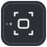
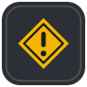
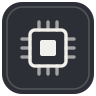
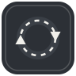
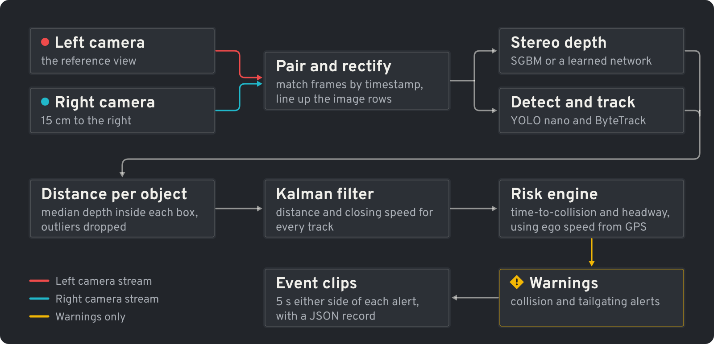
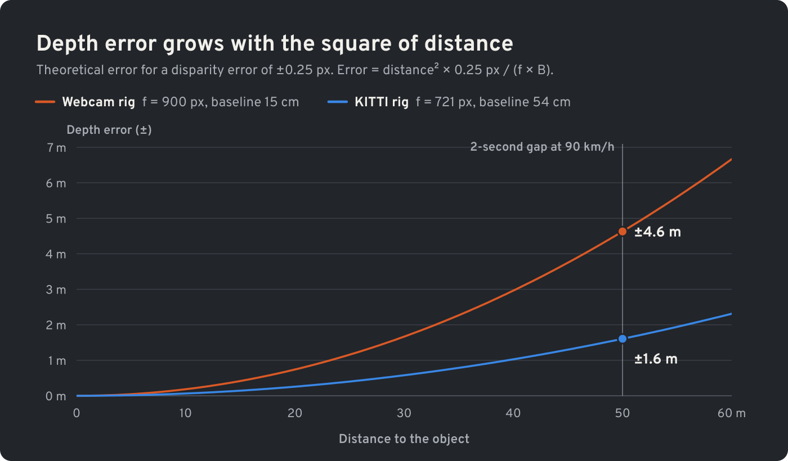
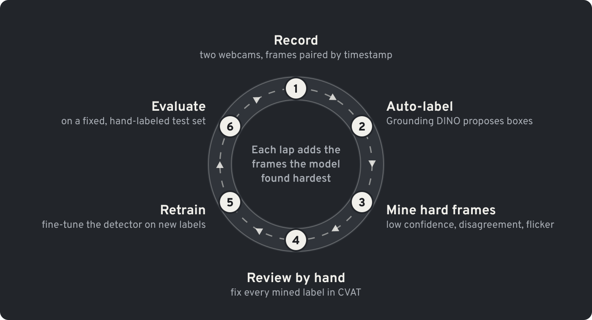
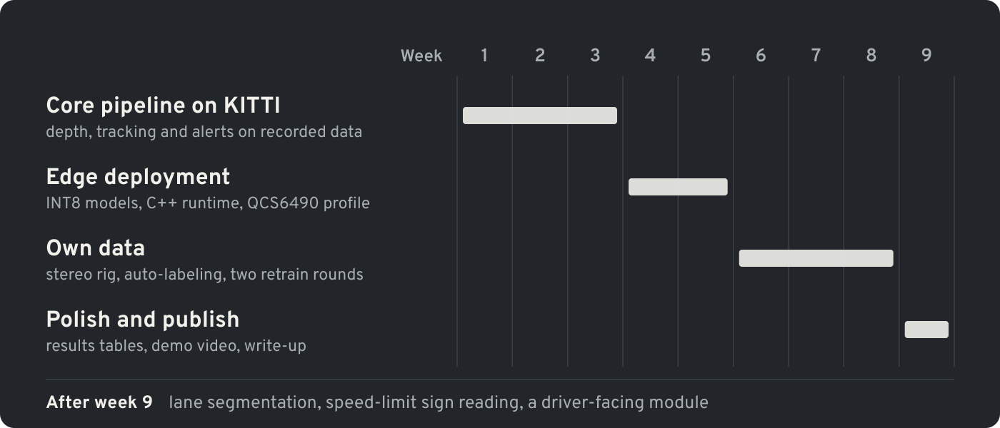

<div align="center">

<p></p>

<p></p>

**[Why](#why-this-project)** &emsp; **[What's inside](#whats-inside)** &emsp; **[Pipeline](#pipeline)** &emsp; **[Results](#results)** &emsp; **[How it works](#how-it-works)** &emsp; **[Get started](#getting-started)** &emsp; **[Roadmap](#roadmap)**

</div>

> [!NOTE]
> **Work in progress.** This is a research prototype, not a safety system: never rely on it while driving. The results tables fill in as each phase lands (see the [roadmap](#roadmap)).

## Why this project

Commercial fleet dashcams have started adding a second forward camera. One camera has to guess distance from how big things look; two cameras measure it from geometry. Nearer objects shift further between the left and right views (the banner draws that shift in red and cyan), and the shift, called disparity, converts directly into metres. Reliable distance gives reliable closing speed, and reliable closing speed gives collision warnings that drivers can trust.

Stereo-Collision-Warning rebuilds that capability from scratch on open data and two cheap webcams, then deploys it to the QCS6490, a Qualcomm chip used in current commercial AI dashcams. The interesting work is in the unglamorous parts: calibration, camera sync, measurement noise that grows with distance, keeping false alerts rare, and fitting several models into one latency budget.

## What's inside

<table>
<tr>
<td width="64" valign="top"></td>
<td valign="top"><b>Stereo geometry</b><br>
Calibration, rectification and metric depth, with an error model the tracker reuses.<br>
<i>Camera models, epipolar geometry, triangulation</i></td>
</tr>
<tr>
<td width="64" valign="top"></td>
<td valign="top"><b>Depth showdown</b><br>
Classical SGBM vs. a lightweight learned stereo network vs. a monocular model, scored against LiDAR by range.<br>
<i>Deep stereo, evaluation design</i></td>
</tr>
<tr>
<td width="64" valign="top"></td>
<td valign="top"><b>Detection and tracking</b><br>
Nano YOLO fine-tuned for South Asian traffic (auto-rickshaws, motorbikes, animals), plus ByteTrack.<br>
<i>Fine-tuning, multi-object tracking</i></td>
</tr>
<tr>
<td width="64" valign="top"></td>
<td valign="top"><b>Risk engine</b><br>
A Kalman filter per object gives closing speed, time-to-collision and headway, then debounced alerts and event clips.<br>
<i>State estimation, event logic</i></td>
</tr>
<tr>
<td width="64" valign="top"></td>
<td valign="top"><b>Edge runtime</b><br>
ONNX, INT8 and a C++ real-time loop, profiled on a hosted Qualcomm QCS6490.<br>
<i>Quantization, latency budgets, C++</i></td>
</tr>
<tr>
<td width="64" valign="top"></td>
<td valign="top"><b>Data engine</b><br>
Own stereo footage, auto-labels, hard-example mining, human review, retraining.<br>
<i>Active learning, distribution shift</i></td>
</tr>
</table>

## Pipeline

<p></p>

Red and cyan always mean the left and right camera. Yellow is reserved for warnings.

## Results

Measured numbers are filled in from `notebooks/` as each phase completes. The only pre-filled values are theoretical bounds, marked in italics.

### Depth accuracy vs. LiDAR (KITTI, per object, median absolute error in m)

| Method | 0–20 m | 20–40 m | 40–60 m | Runtime on laptop (ms) |
|---|---:|---:|---:|---:|
| SGBM (OpenCV) | — | — | — | — |
| Learned stereo (e.g. HITNet) | — | — | — | — |
| Monocular (Depth Anything, metric) | — | — | — | — |
| *Theory: stereo error at 20 / 40 / 60 m, ±0.25 px* | *0.26* | *1.03* | *2.31* | — |

### Alert quality

| Metric | Result | Measured on |
|---|---:|---|
| Forward collision warning recall | — | CARLA stereo near-miss scenarios with ground truth |
| Median warning lead time (s) | — | Same scenarios |
| False alerts per hour | — | Normal driving footage, every alert reviewed by hand |
| Median TTC error (s) when TTC < 6 s | — | KITTI tracking 3D labels |

### Edge performance (Qualcomm QCS6490, hosted via Qualcomm AI Hub)

| Model | Precision | Input | Latency (ms) | Main compute unit | Accuracy vs. FP32 |
|---|---|---|---:|---|---|
| Detector (YOLO nano) | FP32 | 640×384 | — | — | baseline |
| Detector (YOLO nano) | INT8 | 640×384 | — | — | — mAP50 |
| Learned stereo | INT8 | — | — | — | — m depth error |

**End-to-end on device:** — FPS at 640 px width.

### Data engine (own Pakistani-road test set)

| Round | Hand-labeled frames | Auto-labeled frames | mAP50 (all) | mAP50 (rickshaw, motorbike, animal) | False alerts / hr |
|---|---:|---:|---:|---|---:|
| 0: IDD only | 0 | 0 | — | — | — |
| 1 | — | — | — | — | — |
| 2 | — | — | — | — | — |

### Targets

| Goal | Target |
|---|---|
| End-to-end speed on QCS6490 | ≥ 10 FPS at 640 px width |
| False collision warnings | < 1 per hour of normal driving |
| Depth error up to 40 m | Within 1.5× the theoretical stereo bound |
| INT8 accuracy cost | ≤ 1 mAP50 point |

## How it works

### 1. Stereo geometry

Each camera pair is calibrated with a checkerboard (`cv2.stereoCalibrate`), then rectified (`cv2.stereoRectify`) so matching points lie on the same image row. Depth follows from disparity:

$$Z = \frac{f \cdot B}{d}$$

Differentiating gives the error model:

$$\Delta Z \approx \frac{Z^2}{f \cdot B}\,\Delta d$$

Depth error grows with the **square** of distance, so baseline and focal length matter a lot. At a 2-second gap on a 90 km/h road, a 15 cm webcam rig is uncertain by almost three times as much as KITTI's 54 cm rig:

<p></p>

<details>
<summary><b>Exact values</b></summary>

<br>

| Rig | f (px) | Baseline | Error at 20 m | At 40 m | At 50 m | At 60 m |
|---|---:|---:|---:|---:|---:|---:|
| KITTI | 721 | 0.54 m | 0.26 m | 1.03 m | 1.61 m | 2.31 m |
| Webcam rig (720p, ~70° HFOV) | ~900 | 0.15 m | 0.74 m | 2.96 m | 4.63 m | 6.67 m |

*Assumes ±0.25 px disparity error. The disparity search range sets the closest measurable distance, `Z_min = f * B / d_max`: about 2 m for KITTI with 192 levels, about 1 m for the webcam rig with 128.*

</details>

The same model sets the tracker's measurement noise, so far-away objects are trusted less:

$$\sigma_Z(Z) = \frac{Z^2}{f \cdot B}\,\sigma_d$$

### 2. Distance per object

Depth inside a bounding box mixes the object with road and background. The system takes the median of valid depth values in the box's lower-central region (inner half of the width, 40–90 % of the height) and drops outliers beyond 3 MAD. Lateral position comes for free: `X = (u - c_x) * Z / f`.

### 3. Tracking and state estimation

ByteTrack assigns IDs. Each track then gets a constant-velocity Kalman filter over [distance, range rate], with measurement noise taken from the error model above. Differencing raw distances amplifies noise badly at range; the filter produces a closing speed you can act on.

- **Closing speed:** v_c = −ḋ, from the filter
- **Time-to-collision:** TTC = d / v_c, only when v_c > 0.5 m/s
- **Headway:** THW = d / v_ego, with ego speed from KITTI's OXTS data or a phone GPS log

### 4. Alert logic

- **In-path check:** |X| < 1.5 m (a straight-corridor assumption; the lane-segmentation stretch goal replaces it on curves)
- **Forward collision warning:** TTC below threshold in k of the last n frames
- **Close following:** headway below threshold for a minimum duration, above a minimum ego speed
- **Hysteresis and per-track cooldown,** so alerts don't flicker or repeat
- **Event clips:** a ring buffer saves 5 s before and after each alert, plus a JSON record (track ID, distance, TTC, ego speed)

<details>
<summary><b>Alert settings</b> (<code>configs/alerts.yaml</code>)</summary>

```yaml
# Starting points; tune on your own footage
in_path:
  corridor_half_width_m: 1.5
fcw:
  ttc_threshold_s: 2.5
  min_closing_speed_mps: 0.5
  confirm: {k: 4, n: 6}
close_following:
  headway_threshold_s: 1.0
  min_duration_s: 5
  min_ego_speed_kmh: 30
cooldown_s: 10
event_clip:
  pre_s: 5
  post_s: 5
```

</details>

### 5. Edge deployment

1. Export the detector and the learned stereo network to ONNX.
2. Quantize to INT8 with ONNX Runtime static (QDQ) quantization, calibrated on about 500 frames of my own footage, then re-measure accuracy.
3. Compile and profile on a hosted QCS6490 through Qualcomm AI Hub.
4. Run the C++ runtime: capture threads, frame pairing, inference (ONNX Runtime), tracker and risk engine, connected by bounded queues so a slow stage drops frames instead of building lag.

Stereo networks often use operations (cost volumes, warping) that fall back to the CPU on mobile NPUs. If that happens, the results say so and SGBM stays the on-device depth path.

<details>
<summary><b>Profiling on the QCS6490</b> (<code>edge/aihub_profile.py</code>)</summary>

```python
# Written against qai-hub 0.56; check the docs if a call has changed
import numpy as np
import qai_hub as hub

client = hub.Client()                    # uses the token saved by `qai-hub configure --api_token ...`
device = hub.Device("QCS6490 (Proxy)")   # confirm the exact name with `qai-hub list-devices`

compile_job = client.submit_compile_job(
    model="build/detector_int8.onnx",
    device=device,
    options="--target_runtime tflite",
)
target_model = compile_job.get_target_model()

frame = np.load("data/sample_input.npy")  # one preprocessed frame, shape (1, 3, 384, 640)
client.submit_inference_job(
    model=target_model,
    device=device,
    inputs={"images": [frame]},
    profile=True,                         # per-layer latency and compute unit on the real chip
)
```

</details>

### 6. Data engine

<p></p>

- **Auto-labeling:** Grounding DINO with text prompts such as auto rickshaw, motorcycle, truck, cow and donkey cart.
- **Mining:** keep frames where detector confidence sits in the uncertain band (0.3–0.6), where the detector and the auto-labeler disagree, or where a track flickers on and off.
- **Review:** every mined label is checked by hand. Auto-labels are a starting point, not ground truth.
- **Test set:** hand-labeled once and never used for training, so rounds stay comparable.

## Datasets

| Dataset | Used for | Notes |
|---|---|---|
| [KITTI](https://www.cvlibs.net/datasets/kitti/) (stereo 2015, raw, tracking) | Pipeline development, depth and TTC evaluation | Calibrated stereo, Velodyne LiDAR, OXTS ego speed, 3D labels |
| [IDD](https://idd.insaan.iiit.ac.in/), India Driving Dataset | Detector fine-tuning | South Asian traffic classes such as autorickshaw, motorcycle and animal |
| [CARLA](https://carla.org/) (simulated) | Alert recall and lead time | Stereo near-miss scenarios with exact ground truth, no risky driving needed |
| Own recordings, Pakistan | Data engine, false-alert rate, final test set | Two USB webcams, ~15 cm baseline |

Raw data is never committed. Scripts in `tools/` prepare each dataset after you download it from the official site.

## Hardware for the own rig

- 2 × identical USB webcams: same model, with focus, exposure and white balance locked
- A rigid aluminum bar with a 12–20 cm baseline, mounted so it cannot flex
- A phone logging timestamped GPS for ego speed
- A laptop for recording, run by a passenger

**Synchronization:** USB webcams are not hardware-synced. At 50 km/h, a 20 ms gap between left and right frames means the car moves about 0.28 m between the two exposures. The recorder timestamps every frame on arrival, pairs nearest neighbors, and drops pairs more than 10 ms apart (configurable). To measure your real offset, film a millisecond timer on a screen with both cameras.

## Getting started

### Install

```bash
git clone https://github.com/<your-username>/stereo-collision-warning.git
cd stereo-collision-warning
python -m venv .venv && source .venv/bin/activate
pip install -e ".[dev]"
pytest                      # geometry, Kalman filter and alert-logic tests
```

### Run on KITTI

```bash
# Download a KITTI raw drive and its calibration from the official site first
python tools/prepare_kitti.py --root data/kitti
python -m scw.run --source kitti --drive 2011_09_26_drive_0005 --depth sgbm --show
```

<details>
<summary><b>Evaluate</b></summary>

```bash
python -m scw.eval.depth  --split kitti_val --methods sgbm,learned_stereo,mono
python -m scw.eval.alerts --footage data/own/normal_driving --out reports/alerts.md
```

</details>

<details>
<summary><b>Calibrate your own rig</b></summary>

```bash
python calib/capture_pairs.py    --left 0 --right 1 --out calib/captures
python calib/calibrate_stereo.py --images calib/captures --board 9x6 --square-mm 25 \
                                 --out configs/rig_webcam.yaml
```

Aim for an RMS reprojection error below about 0.5 px, and recapture if it is higher.

</details>

<details>
<summary><b>Build for the edge</b></summary>

```bash
python edge/export_onnx.py   --model detector --out build/detector.onnx
python edge/quantize_int8.py --model build/detector.onnx --calib data/own/calib_frames \
                             --out build/detector_int8.onnx
python edge/aihub_profile.py --model build/detector_int8.onnx --device "QCS6490 (Proxy)"

cmake -S cpp -B build/cpp -DCMAKE_BUILD_TYPE=Release
cmake --build build/cpp -j
./build/cpp/scw_rt --config configs/rig_webcam.yaml
```

</details>

<details>
<summary><b>Repository layout</b></summary>

```text
stereo-collision-warning/
├── scw/                    # Python package
│   ├── sources/            # camera capture, frame pairing, KITTI and CARLA loaders
│   ├── depth/              # SGBM, learned stereo, monocular baseline
│   ├── detect/             # detector wrapper and fine-tuning scripts
│   ├── track/              # ByteTrack integration
│   ├── risk/               # Kalman filter, TTC, headway, alert state machine
│   ├── data_engine/        # auto-labeling, hard-example mining, dataset versions
│   ├── eval/               # depth, detection, tracking and alert metrics
│   └── run.py              # end-to-end demo entry point
├── cpp/                    # real-time C++ runtime (ONNX Runtime)
├── edge/                   # ONNX export, INT8 quantization, AI Hub profiling
├── calib/                  # checkerboard capture and stereo calibration
├── configs/                # rig, model and alert settings (YAML)
├── tools/                  # dataset prep, recording, anonymization, visualization
├── notebooks/              # analysis that produces the README tables and plots
├── tests/                  # unit tests: geometry, Kalman filter, alert logic
├── assets/                 # banner, diagrams, chart and icons for this README
└── README.md
```

</details>

## Evaluation protocol

- **Depth:** per-object error against the LiDAR points inside each KITTI 3D box, bucketed by range.
- **Detection:** mAP50 and mAP50-95 on IDD val and on the own test set, plus per-class recall for rickshaws, motorbikes and animals.
- **Tracking:** HOTA and IDF1 on KITTI tracking.
- **Alerts:** recall and lead time on CARLA scenarios (lead vehicle braking hard, cut-in, pedestrian crossing), and false alerts per hour on real normal driving.
- **Robustness slices:** day, night, rain, dust and low sun reported separately, because averages hide failures.
- **Latency:** per stage and end-to-end, on a laptop CPU and on the QCS6490.

## Design decisions

- **Stereo over monocular.** Monocular depth is learned and its errors depend on the scene. Stereo error follows a known formula, so the system knows how much to trust each measurement.
- **A Kalman filter instead of differencing.** Differencing noisy distances at 10–30 Hz produces closing speeds too noisy to act on. The filter smooths them with a motion model and the error model.
- **INT8 wherever accuracy holds up.** The NPU is much faster at INT8, but the accuracy cost is measured and reported, not assumed.
- **False alerts per hour as the headline metric.** Drivers learn to ignore, or unplug, systems that warn too often.
- **Near misses come from simulation.** They can't be staged safely on real roads.

## Roadmap

<p></p>

<details>
<summary><b>Checklist</b></summary>

**Phase 1: core pipeline on KITTI (weeks 1–3)**
- [ ] Rectification, SGBM depth, LiDAR evaluation by range
- [ ] Learned stereo and monocular baselines (depth showdown)
- [ ] Detector + ByteTrack
- [ ] Kalman filter, TTC, headway, alert state machine
- [ ] First demo video

**Phase 2: edge (weeks 4–5)**
- [ ] ONNX export, INT8 quantization, accuracy check
- [ ] C++ real-time runtime
- [ ] QCS6490 profiling via Qualcomm AI Hub

**Phase 3: own data (weeks 6–8)**
- [ ] Build and calibrate the rig; frame pairing; GPS logging
- [ ] Record and anonymize footage
- [ ] IDD fine-tune, auto-labeling, hard-example mining, two retrain rounds
- [ ] CARLA near-miss scenarios for alert recall

**Phase 4: polish (week 9)**
- [ ] Fill in every results table
- [ ] Demo GIF and 60-second video
- [ ] Short write-up or blog post

**Stretch goals**
- [ ] Lane segmentation for lane-drift alerts and a better in-path check on curves
- [ ] Speed-limit sign detection and reading, fused with GPS speed
- [ ] Driver-facing module: phone use and drowsiness

</details>

## Safety, privacy and licensing

- **Not a safety system.** Stereo-Collision-Warning is a research prototype. Don't rely on its alerts.
- **Recording safely.** The rig is mounted before the drive and never adjusted while moving; a passenger runs the laptop.
- **Privacy.** Raw footage stays on an encrypted local drive. Anything published (GIFs, sample frames) has faces and license plates blurred with `tools/anonymize.py`.
- **Licensing.** Code in this repo is MIT. Third-party parts keep their own licenses: Ultralytics YOLO is AGPL-3.0, KITTI is CC BY-NC-SA 3.0, and IDD has its own terms. Check them before reuse.

## What I learned

_Notes from each phase will go here._

<!-- Fill this in as you build: 3–5 specific bullets, such as a bug that took days, a number that surprised you, or a trade-off you'd make differently. Interviewers read this section. -->

## References

<details>
<summary><b>Papers and docs</b></summary>

1. A. Geiger, P. Lenz, R. Urtasun. *Are we ready for Autonomous Driving? The KITTI Vision Benchmark Suite.* CVPR 2012.
2. M. Menze, A. Geiger. *Object Scene Flow for Autonomous Vehicles.* CVPR 2015.
3. H. Hirschmüller. *Stereo Processing by Semiglobal Matching and Mutual Information.* IEEE TPAMI, 2008.
4. V. Tankovich et al. *HITNet: Hierarchical Iterative Tile Refinement Network for Real-time Stereo Matching.* CVPR 2021.
5. L. Yang et al. *Depth Anything: Unleashing the Power of Large-Scale Unlabeled Data.* CVPR 2024.
6. Y. Zhang et al. *ByteTrack: Multi-Object Tracking by Associating Every Detection Box.* ECCV 2022.
7. S. Liu et al. *Grounding DINO: Marrying DINO with Grounded Pre-Training for Open-Set Object Detection.* ECCV 2024.
8. G. Varma et al. *IDD: A Dataset for Exploring Problems of Autonomous Navigation in Unconstrained Environments.* WACV 2019.
9. A. Dosovitskiy et al. *CARLA: An Open Urban Driving Simulator.* CoRL 2017.
10. R. E. Kalman. *A New Approach to Linear Filtering and Prediction Problems.* Journal of Basic Engineering, 1960.
11. [Qualcomm AI Hub documentation](https://workbench.aihub.qualcomm.com/docs/) and [ONNX Runtime quantization guide](https://onnxruntime.ai/docs/performance/model-optimizations/quantization.html).

</details>

---

<div align="center">

**Your Name** &emsp; [LinkedIn](https://www.linkedin.com/in/your-handle) &emsp; [GitHub](https://github.com/your-username)

Released under the [MIT License](LICENSE).

</div>
